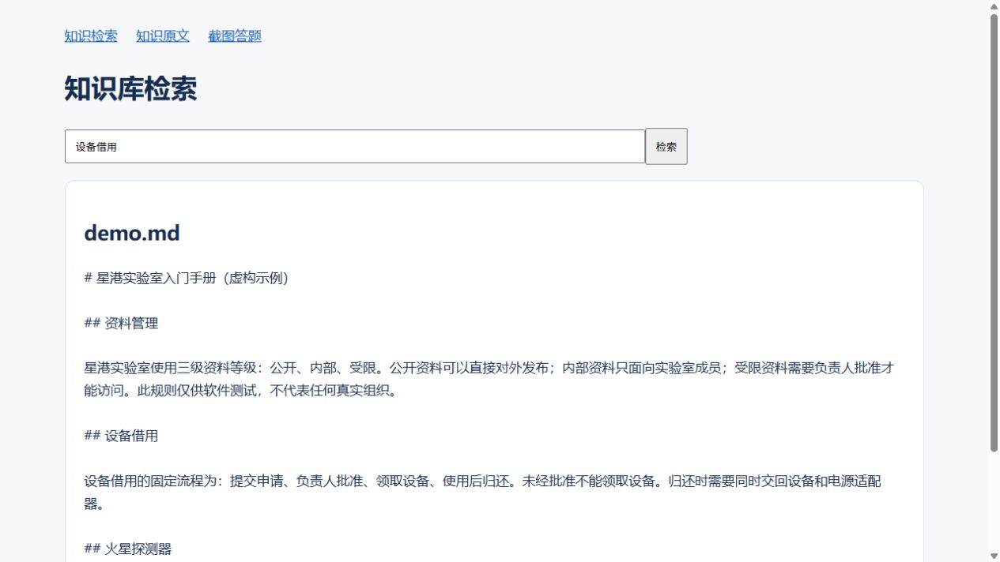
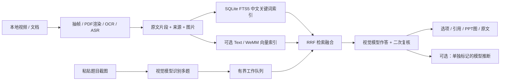

# Knowledge Exam Assistant

把本地视频和文档整理成可追溯的知识库，再用题目截图进行单选、多选练习。系统先识别题干与全部选项，检索相关原文、视频画面和文档页面，再给出建议答案、逐项判断及引用。

这是一个独立、通用的 Python 仓库。仓库仅含代码、配置模板和虚构示例，不含真实组织的培训资料、题库、作答记录、模型权重或凭据。



## 可以做什么

- 导入 Markdown、TXT、PDF、DOCX、PPTX、图片，以及 MP4/MKV/MOV/WebM 视频。
- 提取视频画面、PDF 页面、OCR 和可选语音转写；生成带来源的知识原文汇编。
- 先用中文关键词检索跑通，再按需启用文字向量或 WeMM 图片与文字向量检索。
- 粘贴或选择最多 100 张题图，每张最多 5 题；设置 1–8 路并发，任务完成后自动补位。
- 展示相关图片、原文段落和视频时间点；导出答题 Markdown/JSON。
- 区分“课程材料支持的建议”和“无充分依据的模型推断”，允许关闭推断。

“有依据”表示模型审查通过，不保证正确。适用于资料学习、模拟测验和允许查阅资料的练习；系统不会登录考试平台或自动提交答案。

## 架构



WeMM 负责“这段文字对应哪张图、哪个段落”，视觉生成模型负责“看懂题目并根据证据作答”。两者可以部署在不同机器上。只有启用 `embedding.backend="wemm"` 才会对原图建立多模态向量；文字模式使用 OCR/文档原文向量，关键词模式没有向量。

## 硬件与软件

以下是容量规划建议，不是已测得的最低要求；实际显存受模型版本、图片大小和同时运行的模型影响。

| 场景 | 建议资源 | 本地显卡 |
|---|---|---|
| 文本检索 + 外部视觉 API | 4 核 CPU、8 GB RAM、10 GB 可用空间 | 不需要 |
| 视频抽帧 / CPU OCR / CPU ASR | 8 核以上、16–32 GB RAM、原视频之外再留 30–100 GB | 可不需要，转写会较慢 |
| WeMM 2B + 外部视觉 API | 32 GB RAM；建议至少 12 GB 可用显存并实测峰值 | NVIDIA CUDA 或适配的 AMD ROCm |
| WeMM 4B + 外部视觉 API | 32 GB RAM；建议 24 GB 显卡并为激活值留空间 | 同上 |
| 全部本地推理 | 需叠加视觉生成模型的显存/内存预算 | 24 GB 不保证能同时放下大型生成模型与 WeMM |

推荐 Linux、Python 3.12（代码要求 ≥3.11）。基础版只依赖 NumPy、Pillow、Python 自带 SQLite FTS5；视频需 OpenCV，语音转写需 FFmpeg/faster-whisper，PDF 需 PyMuPDF，PPTX 需 LibreOffice，OCR 为可选 RapidOCR。WeMM 使用 PyTorch、Transformers 和 qwen-vl-utils。

AMD 的 PyTorch 仍使用 `device="cuda"`；faster-whisper 使用 CTranslate2，不能直接用 ROCm 加速。本项目默认让 ASR 在 CPU/int8 上运行。

## 先跑通：Linux 最小示例

下面在仓库根目录执行。完整教程见 [逐步部署](docs/SETUP.md)。

```bash
python3.12 -m venv .venv
source .venv/bin/activate
python -m pip install --upgrade pip
python -m pip install -e .
cp config.example.toml config.toml

mkdir -p private/inputs
cp examples/demo.md private/inputs/
kexam doctor
kexam ingest private/inputs
kexam index
kexam search '设备借用流程'
kexam serve
```

打开 `http://127.0.0.1:8765/` 搜索，`/handbook` 阅读原文。此时未配置可用视觉模型，搜索可以运行，截图作答需要下一步。

编辑 `config.toml` 的 `[quiz]`，填写兼容 **Chat Completions 且支持图片输入** 的完整 endpoint 和模型名。需要密钥时，在启动服务的终端设置环境变量：

```bash
read -rsp 'Vision API key: ' KEXAM_API_KEY; echo
export KEXAM_API_KEY
kexam serve
```

然后访问 `/quiz`。`.env` 是 systemd 的可选配置文件，CLI 不会自动读取它。请勿将密钥放进示例、截图、提交历史或公开仓库。

## 文档导航

- [从零搭建、视频导入、WeMM 2B/4B、系统服务](docs/SETUP.md)
- [架构、数据协议与执行链路](docs/ARCHITECTURE.md)
- [运维、API、故障处理与扩展路线](docs/OPERATIONS.md)
- [验证范围和已知限制](docs/VALIDATION.md)
- [依赖与上游资料](docs/DEPENDENCIES.md)

## 仓库结构

```text
src/kexam/
  cli.py          # ingest / index / search / serve / doctor
  config.py       # TOML 配置及相对路径解析
  ingest.py       # 文档、图片、视频导入
  embedding.py    # 可选文字 / WeMM 编码器
  retrieval.py    # 原子索引发布、向量缓存、FTS/RRF
  quiz.py         # 多题识别、队列、证据审核、推断、导出
  server.py       # 本地 HTTP API、检索、阅读器和视频回看
  templates/      # 截图答题页面
tests/            # 虚构数据与模拟模型，不包含真实题库
examples/         # 虚构知识和评测标签，标签不能导入知识库
deploy/           # systemd 用户服务模板
docs/             # 安装、设计、运维和验证文档
```

## 开发与范围

```bash
python -m unittest discover -s tests -v
```

当前是单用户、本地运行的可用基础版。基础导入和关键词检索无需 GPU；GPU 与第三方 API 的完整验收需在部署环境按教程执行。未实现多用户权限、生产级公共网络服务、自动无损续跑付费 API 请求、人工标准答案管理或准确率保证。

仓库不预设开源许可证；如需公开发布，请自行确定代码许可，并检查模型和可选依赖的许可要求。
